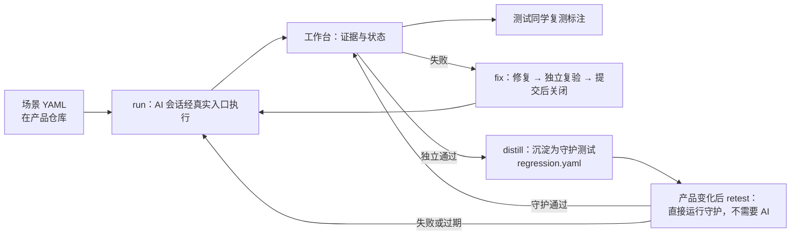

# Flow Board

> 以业务 SOP 场景为中心的验收工具：AI 会话经真实入口执行场景、留证；测试同学在看板上按场景复测；修复由独立会话复验；通过的场景沉淀成低成本守护测试，产品变化后先跑守护，不必每次整条重跑。

命令名为 `sop-board`，运行在开发者本机。

## 核心闭环



- **场景文件是唯一真相**：场景 YAML 放在产品仓库，随分支与 worktree 走；会话直接编辑，开发者审核提交。看板只按场景内容指纹与产品快照记录结果。
- **一条路径**：所有 AI 工作都经 `sop-board` 命令完成。看板上的“AI 重跑”只是用同一份技能启动一个无头会话。
- **多 worktree**：同一项目的 main 与各个 git worktree 自动识别为不同检出，结果、快照、环境端口和浏览器各自隔离。
- **自带浏览器**：看板守护进程启动固定版本的 Google Chrome for Testing（每个检出×身份一份持久 profile，缺省无头），不接管你日常用的 Chrome。
- **自动署名**：登记以本机操作者（缺省 `git config user.name`）署名，会话不再反复询问确认人。

## 快速开始

```sh
uv tool install <本仓检出路径>
sop-board skills install                    # 安装随包技能到 Codex 与 Claude Code
sop-board browser install                   # Playwright 1.64.1 + Chrome for Testing
sop-board init demo /path/to/app /path/to/lib
sop-board guide                             # 按指引写 config.yaml、adapter 与项目验证技能
sop-board serve demo --lan                  # 看板守护进程：工作台、环境、浏览器、无头会话
sop-board check
```

之后在产品仓库的 Codex / Claude Code 会话中直接说“执行 SOP 验收”“修复这个失败场景”“把通过的场景沉淀成回归测试”“合并收件箱里的用例”即可，随包 `sop-board` 技能会调用对应命令。

## 角色与入口

| 谁 | 在哪里 | 做什么 |
| --- | --- | --- |
| 测试同学 | 内网工作台 | 按场景查看四要素与证据、复测标注（通过、不通过、阻塞、需求变更）、答复问题、批注草稿、上传用例或 SOP |
| 开发者 | 本机工作台、终端 | 启动守护进程、AI 重跑、运行守护、沉淀、审核并提交会话的改动 |
| AI 会话 | 产品仓库中的 Codex / Claude Code | 写 SOP、合并用例、执行场景、修复、复验、沉淀守护测试 |

## 常用命令

| 场景 | 命令 |
| --- | --- |
| 看状态 | `sop-board status` |
| 执行待执行场景 | `sop-board run prepare` → 按 prompt.md 执行 → `sop-board run submit --run N` |
| 让独立会话执行 | `sop-board run launch --scope <场景>…`，`sop-board run wait` |
| 产品变化后复核 | `sop-board retest` |
| 沉淀守护测试 | `sop-board distill prepare` → 写测试与 guard.json → `sop-board distill submit` |
| 修复 | `sop-board fix prepare` → 改代码 → `fix submit` → 另一会话 `run prepare --fix N` → 提交后 `fix close` |
| worktree | `sop-board checkout list`，`sop-board checkout create <名称>` |
| 真人登录 | `sop-board browser open --identity <身份> --headed`，登录后 `browser close` |

## 文档

| 文档 | 内容 |
| --- | --- |
| [`sop-board guide`](src/sop_board/guide.md) | 搭建项目：config.yaml、适配契约、验证技能 |
| [docs/standard.md](docs/standard.md) | 业务验收与质量改进标准（唯一正文） |
| [docs/sop-guide.md](docs/sop-guide.md) | SOP 业务场景怎样写 |
| [docs/reference.md](docs/reference.md) | 命令、文件契约、状态、错误码 |
| [docs/playwright-acceptance.md](docs/playwright-acceptance.md) | Web 场景与浏览器代理 |
| [docs/design.md](docs/design.md) | v10 设计与取舍 |
| [docs/verification.md](docs/verification.md) | 本仓自身的验收方法 |
| [docs/sop/](docs/sop) | 本仓现行验收场景集 |
