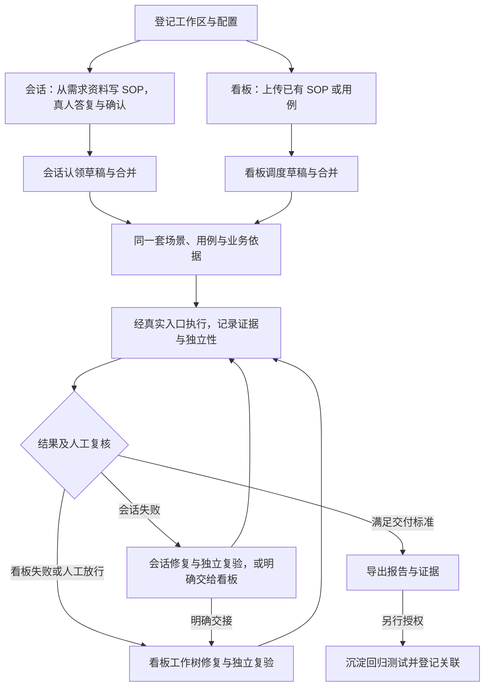

<div align="center">


[](pyproject.toml)
[](https://docs.astral.sh/uv/)
[](#-核心理念自动化闭环)
[](docs/playwright-acceptance.md)
[](#-jira-联动)
[](#)

</div>

---

> **Flow Board**（命令名 `sop-board`）是运行在开发者本机的流程验收看板。
> 它优先以**业务 SOP** 作为验收依据，把**测试同事、开发者与 AI Agent** 编排进同一条流水线：
> 测试同事可经看板上传与复核，开发者也可在 Codex 或 Claude Code 会话中完成五个阶段。两个入口使用同一套任务、校验和业务记录；业务答复与确认由使用者给出。

## ✦ 目录

- [核心理念：自动化闭环](#-核心理念自动化闭环)
- [什么是 SOP 业务场景](#-什么是-sop-业务场景)
- [五个阶段](#-五个阶段)
- [端到端流程全景](#-端到端流程全景)
- [系统架构](#-系统架构)
- [快速开始](#-快速开始)
- [角色与入口](#-角色与入口)
- [设计原则](#-设计原则)
- [文档索引](#-文档索引)

## ⚡ 核心理念：自动化闭环

传统验收中，用例、执行、缺陷、修复散落在不同工具和不同人手里，每一次交接都在丢失上下文。
Flow Board 把它们收束成**一个以 SOP 场景为中心的闭环**：每条场景都有版本、证据与状态，每一个失败都能追溯到根因仓库与修复提交。

<p align="center">
  
</p>

## 📖 什么是 SOP 业务场景

> **一句话：SOP 是业务方确认过的「这件事该怎么办」，SOP 业务场景是拿一个具体的例子，到真实系统上验证「它是不是真的这么办」。**

<p align="center">
  <a href="docs/sop-guide.md"></a>
</p>

### 记住三句话

1. **SOP 是业务方确认过的规则**，不是测试人员的理解，也不是系统现在的表现。
2. **场景是对规则的一次具体验证**：从什么状态开始、做什么、必须看到什么、绝不能发生什么，四件事缺一不可。
3. **正反都要测，结果要有证据**：该成功的成功，该拦下的拦下，每条结论都附截图、接口响应或数据查询结果。

用退款案例讲清什么是 SOP、怎样写场景，见 **[SOP 业务场景编写指南](docs/sop-guide.md)**。

验收的统一正文是 **[业务验收与质量改进标准](docs/standard.md)**：项目手册设计、账号授权、独立执行、人工复核、重跑与沿用、交付和缺陷复验都从这里进入。[四份记录模板](docs/templates)供项目直接使用。

## 🧬 五个阶段

| 阶段 | 看板入口 | 开发会话入口 | 共同产出 |
| --- | --- | --- | --- |
| 1. 写业务 SOP | 本阶段暂不提供需求资料上传；可直接上传已有 SOP | 从 PRD、需求与评审资料编写；呈报问题、记录真人答复，再由当次确认人确认 | 原文、规则来源及确认记录；会话编写另保留资料摘要与答复 |
| 2. 生成与确认草稿 | 上传 SOP 后调度生成；测试同事批注、修订与确认 | 认领生成任务，按提示词写结果；批注与确认使用真人姓名 | 草稿版本、规则覆盖、依据与问题；确认后成为用例 |
| 3. 合并测试用例 | 上传用例，按缺口回复、追问或决定本批不纳入 | 上传并认领合并，呈报缺口，将本批次本问题的真人答复登记为会话来源 | 流程场景、并入的细节预期、暂缓范围、更新后的用例 |
| 4. 经真实入口执行 | 看板准备环境并调度；自动执行开关与本机手动发起并存 | 默认交未参与实现的新会话，按项目手册准备环境；允许未提交的产品内容 | 结果、证据、产品内容摘要、执行入口与独立性 |
| 5. 修复与独立复验 | 汇总看板失败及已放行的人工失败，在隔离工作树修复、提交、独立复验并核对合入 | 在当前工作区只改产品、不提交；独立新会话复验，开发者自行提交后核对并关闭 | 根因、改动及复验记录；非产品问题交使用者处理 |

会话登记的失败先成为待处理事项，可在会话中继续修复，或由开发者在本机修复页选择“交给看板修复”；看板不会自动接走。仅排队或等待的其他类看板任务不阻挡会话准备；同批次同类任务及实际占用或恢复产品环境的任务仍须处理冲突。已中断、已放弃、已作废的会话任务重新准备时新建，不复活旧记录。

两个入口都保留人的决定。草稿确认人须在本次请求中指定，确认后按使用者决定继续合并；合并答复只用于对应批次和缺口。可确定的流程先落地，暂缓项及其旧内容保留情况单独展示。看板任务输入变化转“待同步”或“已作废”，会话提交旧输入则作废，不能覆盖新内容。

草稿确认产生的合并保持原规则，不自动发起执行；其他场景写入是否自动执行由工作区开关控制。需要执行时仍须满足环境与范围条件。

人工复核贯穿结果交付：测试同事标注通过或不通过，不通过附缺陷原文；完成复核后放行人工失败。报告导出包括版本、轮次、证据和未完成范围。用户另行授权时，可将已确认且经真实入口通过的场景沉淀为回归测试；关联不改变验收结论，也不作为交付条件。

## 🗺 端到端流程全景

从安装搭建到交付导出的完整路径：

登记工作区并配置合格后即可编写 SOP、生成草稿和合并；执行与修复还需要当前自检通过。看板调度和开发会话认领都把结果返回同一工作区与批次。



## 🏗 系统架构

<p align="center">
  
</p>

上图展示看板调度路径。开发会话通过本机命令认领任务；两者共用任务内核、输入核对与登记，认领任务不被看板接管。编写 SOP 暂只开放会话入口。

## 🚀 快速开始

**环境要求**：Python 3.10+、[uv](https://docs.astral.sh/uv/)、Git、`lsof` 与支持 POSIX 进程组的本机环境。看板自动调度还需要已登录的本机 Codex；开发会话入口使用已就绪的 Codex 或 Claude Code。

```sh
# 1. 安装并阅读随包指引（完整搭建契约）
uv tool install <本地看板检出路径>
sop-board guide
sop-board skills install

# 2. 登记工作区：名称 + 全部产品仓库（可分散在任意目录）
sop-board init demo /absolute/app /another/location/lib

# 3. 按指引在数据目录写好 config.yaml、适配脚本与项目验证技能后，运行五步自检
sop-board check demo

# 4. 启动看板；--lan 向内网测试同事开放
sop-board demo --lan --port 8787
```

> [!TIP]
> **交给 AI 搭建**：在 Codex 或 Claude Code 中告诉代理工作区名称与仓库目录，让它运行 `sop-board guide` 并按指引完成搭建。
> 配置、适配和技能写入数据目录（缺省 `~/.sop-board/<名称>/`），真实验证手册在有对应写权限的产品仓库会话中编写或补齐。项目技能与入口配置引用手册章节，凭据仅经环境变量传递。

`sop-board skills install` 将随包的 `sop-board`、`regression-distill` 与 `playwright-acceptance` 链接到当前 `HOME` 下的 `~/.agents/skills/`（Codex）和 `~/.claude/skills/`（Claude Code），输出各客户端实际解析路径及包版本。重复执行或升级后执行会更新本包链接；其他来源的同名目录或链接会列出并跳过。随后可在开发会话中要求“把已确认场景沉淀为回归测试”，按 `regression-distill` 分层编写、运行并登记关联，改动留给开发者审核提交。

已登记工作区可直接在 Codex 或 Claude Code 中要求“根据需求写业务 SOP”“生成验收场景”“合并测试用例”“执行 SOP 验收”或“修复这个失败场景”。随包技能先报告待处理事项，再按阶段准备和登记，看板无需保持运行。命令与冲突处理见[会话入口](docs/reference.md#session-entry)。独立性必须反映真实参与关系；换一个标识不能把实现者自检变成独立验收。

也可在本机看板的场景页勾选可沉淀场景，点击“沉淀为回归测试”。看板在独立工作树启动新的 Codex 会话，完成后自动登记待提交关联。任务页提供工作树路径和改动清单；开发者审核并自行提交后填写各仓完整提交号，标记“已处理”，再确认清理。中断或失败可以重试，原会话材料保留在 `attempts/<序号>/`；放弃保留关联历史。内网只能查看沉淀状态、场景和时间，操作及会话材料仅限本机。完整规则见[回归沉淀与关联](docs/reference.md#回归沉淀与关联)。

看板沉淀遇到未提交产品改动时先显示“待提交”。提交后若通过证据不匹配新产品，转为“待验证”，须由开发者手动执行所列场景；实际执行通过或经有效影响判定沿用后才自动开始。等待本身不会自动发起执行，也不受自动执行开关影响。

<details>
<summary><b>最小配置示例 <code>config.yaml</code></b></summary>

```yaml
repos:
  app: /absolute/app
  lib: /another/location/lib
scenarios: {repo: app, path: docs/sop}
skill: project-verification
entries:
  web:
    surface: web
    address_env: APP_URL
    operate: "按 app 仓库 docs/operations/verification.md 第 2 节 web 入口操作"
    observe: ["按同手册第 3 节核对页面、数据和禁止副作用"]
    evidence: ["按同手册第 3 节保存截图和数据查询"]
    isolation: "按同手册第 4 节准备隔离数据、留证后清理"
adapter:
  env: [python3, env.py]
  ports: [8000]
```

完整字段说明见 [参考手册 · 配置与环境](docs/reference.md#配置与环境)。

</details>

<details>
<summary><b>五步自检</b></summary>

| 步骤 | 核对内容 |
| :-: | --- |
| 1 | 配置与仓库：仓库身份、Git 提交身份 |
| 2 | 端口占用：声明端口空闲，冲突时列出占用进程 |
| 3 | 基线环境：`adapter.env` 就绪、入口地址变量非空 |
| 4 | 临时工作树环境：建立、启动、清理全链路 |
| 5 | 验证技能：文件头、入口标题、辅助技能 |

</details>

## 🎛 角色与入口

| 角色 | 在哪里操作 | 能做什么 |
| --- | --- | --- |
| 🧑‍🔬 **测试同事** | 内网页面 | 上传 SOP 或用例、批注修订及确认草稿、查看场景/结果/证据、人工标注、贴 Jira 单号、提交“复核完成” |
| 👨‍💻 **开发者** | 本机页面（仅回环地址） | 自检、重启环境、发起执行、重新合并、批准修复方案、重试/放弃任务、暂停自动任务 |
| **开发会话** | 已登记产品仓库中的 Codex / Claude Code | 写 SOP、生成草稿、合并、执行、修复与复验；人的答复和确认仍由使用者给出 |
| 🤖 **Codex Agent** | 看板调度 | 合并场景、黑盒执行、根因分析、隔离修复、独立复测 |

### 🔗 Jira 联动

- 不通过时缺陷链接必填，原文保存；`https://<站点>.atlassian.net/browse/<单号>` 会被识别为 Jira Cloud 单据。
- 在启动看板的环境中设置 `JIRA_EMAIL`、`JIRA_API_TOKEN` 后，页面显示单据标题与状态，修复会话读取单据内容。
- 凭据只来自环境变量，不进入页面、日志、报告或修复输入；未配置时缺陷照常登记。

## 🛡 设计原则

| 原则 | 落地方式 |
| --- | --- |
| **SOP 即标准** | 预期优先来自业务 SOP；草稿中明确标注代码推理或批注确认及其依据，不把当前实现的输出当作正确答案 |
| **真实入口** | 验证走真实浏览器与真实接口，留存原始证据；不以单元测试替代验收 |
| **独立复测** | 修复与复测由不同会话执行，复测结果不可沿用 |
| **证据可追溯** | 场景版本、用例内容、产品快照、技能摘要共同决定一轮结果是否有效 |
| **最小信任面** | 开发者操作仅限本机；内网只读取不含路径的问题类别；同源与 JSON 类型校验 |
| **保留工作区** | 看板修复使用独立工作树；会话修复保留当前工作区已有改动、不自行提交。两者失败现场均保留 |

## 📚 文档索引

| 文档 | 内容 |
| --- | --- |
| [`sop-board guide`](src/sop_board/guide.md) | 工作区搭建完整指引（代理与开发者共用） |
| [业务验收与质量改进标准](docs/standard.md) | 验收标准唯一正文；项目手册、授权、独立验收、交付、缺陷与复盘 |
| [记录模板](docs/templates) | 项目验收方案、交付验收、缺陷复验与保护、每周质量复盘 |
| [SOP 业务场景编写指南](docs/sop-guide.md) | 场景文件结构、四要素写法、正反向类型、测试用例模板 |
| [参考手册](docs/reference.md) | 配置、环境、合并执行、跨仓修复、访问范围与全部接口契约 |
| [Web 验收集成](docs/playwright-acceptance.md) | 随包 Playwright 技能、`sop-board playwright` 命令 |
| [验收操作手册](docs/verification.md) | SOP 场景经真实入口验收的命令、核对与留证方式 |
| [`docs/sop/`](docs/sop) | 本项目自身的 SOP 业务场景 |
| [`docs/designs/`](docs/designs) | 各迭代设计方案 |

<div align="center">

---

<sub>Built for teams who believe <b>business SOP is the only source of truth</b>.</sub>

</div>
