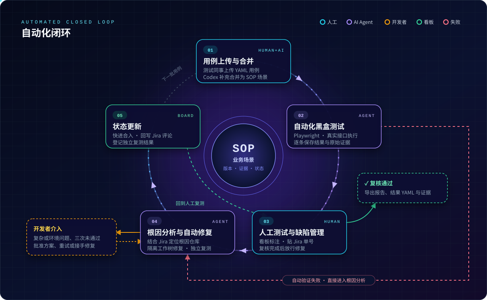
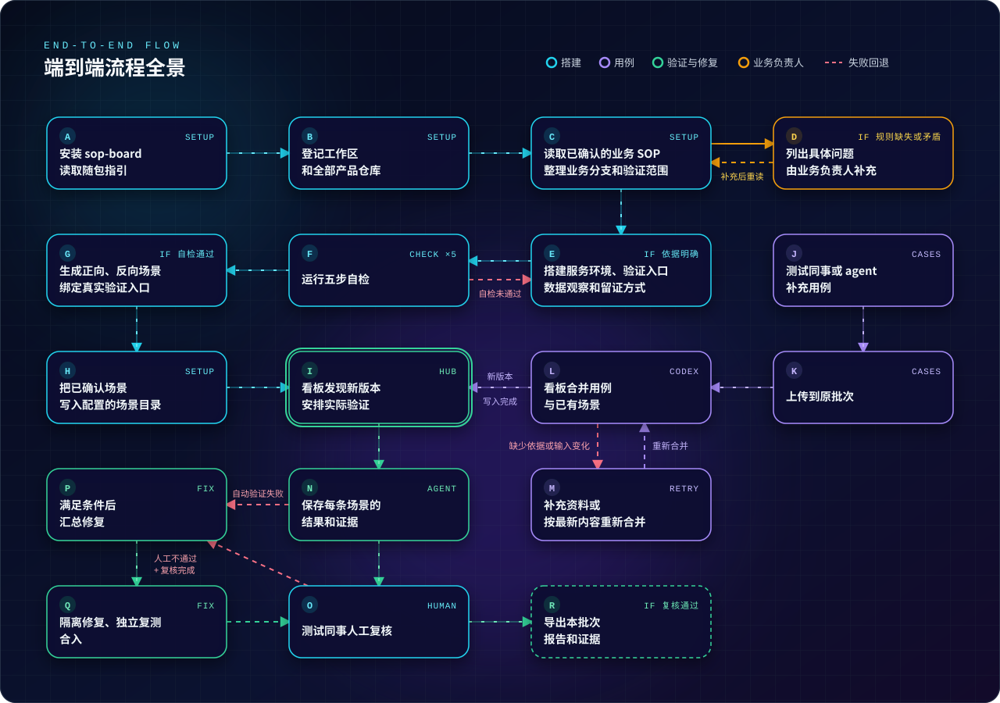
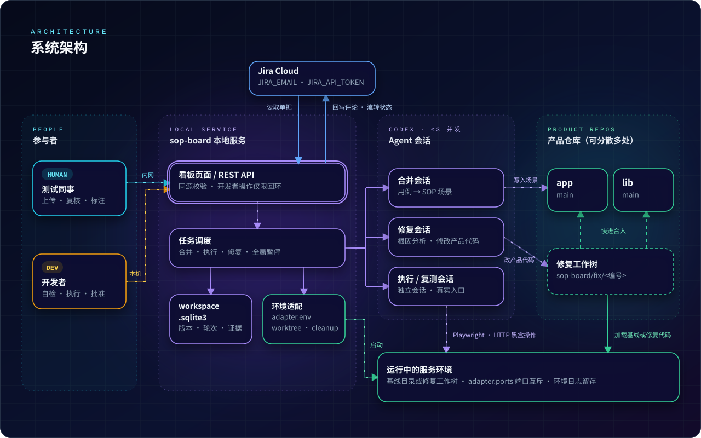

<div align="center">



[](pyproject.toml)
[](https://docs.astral.sh/uv/)
[](#-核心理念自动化闭环)
[](docs/playwright-acceptance.md)
[](#-jira-联动)
[](#)

</div>

---

> **Flow Board**（命令名 `sop-board`）是运行在开发者本机的流程验收看板。
> 它把**业务 SOP** 作为唯一的验收标准，把**测试同事、开发者与 AI Agent** 编排进同一条流水线：
> 测试同事只管上传用例和复核结果，Agent 负责合并场景、跑真实入口、定位根因并修复，开发者只在关键节点拍板。

## ✦ 目录

- [核心理念：自动化闭环](#-核心理念自动化闭环)
- [五个阶段](#-五个阶段)
- [端到端流程全景](#-端到端流程全景)
- [系统架构](#-系统架构)
- [快速开始](#-快速开始)
- [角色与入口](#-角色与入口)
- [设计原则](#-设计原则)
- [文档索引](#-文档索引)

## ⚡ 核心理念：自动化闭环

传统验收中，用例、执行、缺陷、修复散落在不同工具和不同人手里，每一次交接都在丢失上下文。
Flow Board 把它们收束成**一个以 SOP 场景为中心的闭环**：每条场景都有版本、证据与状态，每一个失败都能追溯到根因仓库与修复提交。

<p align="center">
  
</p>

## 🧬 五个阶段

### `01` 用例上传与合并

| | |
| --- | --- |
| **触发** | 测试同事在开发者启动的 sop-board 服务（本机或内网）首页上传用例 YAML |
| **动作** | 看板检测到上传成功，调度本机已登录的 Codex 发起合并任务 |
| **规则** | 已有业务 SOP 场景 → **补充合并**；尚无场景 → **以上传用例为标准生成或完善** |
| **产出** | 新版本场景写入配置的场景目录；每条用例标注 `flow`（独立成场景）或 `detail`（并入所属流程），并给出理由 |

> 合并期间若用例、场景或选择发生变化，旧输出自动转为“待同步”，按最新内容重新合并，绝不覆盖他人改动。

### `02` 自动化黑盒测试

| | |
| --- | --- |
| **触发** | 看板发现新场景版本，开发者一键“执行待执行场景”或“重新验证全部场景” |
| **动作** | Codex 读取项目验证技能，经 Playwright 驱动真实浏览器、或调用真实接口，按场景描述做黑盒验证 |
| **增量** | 产品代码变化后由会话判定影响范围：受影响的重跑，可证明不受影响的沿用并写明理由 |
| **产出** | 每条场景的结果与原始证据（截图、视频、请求响应、数据查询）；全部通过后进入人工测试阶段 |

### `03` 人工测试与缺陷管理

| | |
| --- | --- |
| **触发** | 测试同事在看板上逐条复测 SOP 业务场景 |
| **动作** | 标注通过 / 不通过；不通过必须贴上 Jira 单号或缺陷链接 |
| **联动** | Jira Cloud 链接自动读取单据标题与状态，显示在场景旁 |
| **放行** | 复测完成后点击 **“复核完成，开始修复（K 条人工不通过）”**，本批次的人工失败才进入修复队列 |

### `04` 根因分析与自动化修复

| | |
| --- | --- |
| **触发** | Agent 自动验证失败，或测试同事放行的人工“不通过” |
| **分析** | 新 Codex 会话结合失败场景、证据与 Jira 单据内容做根因分析，定位到具体仓库（`root_repo`） |
| **修复** | 在 `sop-board/fix/<编号>` 分支的隔离工作树中修改产品代码，跨仓问题一次处理 |
| **复测** | 修复环境由**另一个独立会话**经真实入口复测，结果不可沿用 |
| **兜底** | 环境或配置类问题、连续三次未通过、合入条件不满足 → 转开发者批准方案、重试或手工处理 |

### `05` 状态更新，形成闭环

| | |
| --- | --- |
| **合入** | 核对各仓基线后逐仓快进合入，重启基线环境，清理工作树与修复分支 |
| **回写** | 看板登记独立复测结果，场景重新回到人工复测队列；Jira 单据追加评论，可按 `JIRA_FIXED_STATUS` 流转状态 |
| **交付** | 复核全部通过后，导出本批次 Markdown 报告、用例/结果 YAML 和按轮次打包的证据 ZIP |

## 🗺 端到端流程全景

从安装搭建到交付导出的完整路径：

<p align="center">
  
</p>

## 🏗 系统架构

<p align="center">
  
</p>

## 🚀 快速开始

**环境要求**：Python 3.10+、[uv](https://docs.astral.sh/uv/)、Git、`lsof`、支持 POSIX 进程组的本机环境，以及已登录的本机 Codex。

```sh
# 1. 安装并阅读随包指引（完整搭建契约）
uv tool install <本地看板检出路径>
sop-board guide

# 2. 登记工作区：名称 + 全部产品仓库（可分散在任意目录）
sop-board init demo /absolute/app /another/location/lib

# 3. 按指引在数据目录写好 config.yaml、适配脚本与项目验证技能后，运行五步自检
sop-board check demo

# 4. 启动看板；--lan 向内网测试同事开放
sop-board demo --lan --port 8787
```

> [!TIP]
> **交给 AI 搭建**：在 Codex 或 Claude Code 中告诉代理工作区名称与仓库目录，让它运行 `sop-board guide` 并按指引完成搭建。
> 代理只向数据目录（缺省 `~/.sop-board/<名称>/`）写入配置，产品仓库保持只读，不记录凭证。

<details>
<summary><b>最小配置示例 <code>config.yaml</code></b></summary>

```yaml
repos:
  app: /absolute/app
  lib: /another/location/lib
scenarios: {repo: app, path: docs/sop}
skill: project-verification
entries:
  web:
    surface: web
    address_env: APP_URL
    operate: 通过真实浏览器执行场景
    observe: [页面, 持久化数据]
    evidence: [截图, 数据查询结果]
    isolation: 每轮独立数据，结束后清理
adapter:
  env: [python3, env.py]
  ports: [8000]
```

完整字段说明见 [参考手册 · 配置与环境](docs/reference.md#配置与环境)。

</details>

<details>
<summary><b>五步自检</b></summary>

| 步骤 | 核对内容 |
| :-: | --- |
| 1 | 配置与仓库：仓库身份、Git 提交身份 |
| 2 | 端口占用：声明端口空闲，冲突时列出占用进程 |
| 3 | 基线环境：`adapter.env` 就绪、入口地址变量非空 |
| 4 | 临时工作树环境：建立、启动、清理全链路 |
| 5 | 验证技能：文件头、入口标题、辅助技能 |

</details>

## 🎛 角色与入口

| 角色 | 在哪里操作 | 能做什么 |
| --- | --- | --- |
| 🧑‍🔬 **测试同事** | 内网页面 | 上传用例、查看场景/结果/证据、人工标注、贴 Jira 单号、提交“复核完成” |
| 👨‍💻 **开发者** | 本机页面（仅回环地址） | 自检、重启环境、发起执行、重新合并、批准修复方案、重试/放弃任务、暂停自动任务 |
| 🤖 **Codex Agent** | 看板调度 | 合并场景、黑盒执行、根因分析、隔离修复、独立复测 |

### 🔗 Jira 联动

- 不通过时缺陷链接必填，原文保存；`https://<站点>.atlassian.net/browse/<单号>` 会被识别为 Jira Cloud 单据。
- 在启动看板的环境中设置 `JIRA_EMAIL`、`JIRA_API_TOKEN` 后，页面显示单据标题与状态，修复会话读取单据内容。
- 凭据只来自环境变量，不进入页面、日志、报告或修复输入；未配置时缺陷照常登记。

## 🛡 设计原则

| 原则 | 落地方式 |
| --- | --- |
| **SOP 即标准** | 预期只来自已确认的业务 SOP，不把当前实现的输出当作正确答案 |
| **真实入口** | 验证走真实浏览器与真实接口，留存原始证据；不以单元测试替代验收 |
| **独立复测** | 修复与复测由不同会话执行，复测结果不可沿用 |
| **证据可追溯** | 场景版本、用例内容、产品快照、技能摘要共同决定一轮结果是否有效 |
| **最小信任面** | 开发者操作仅限本机；内网只读取不含路径的问题类别；同源与 JSON 类型校验 |
| **隔离不破坏** | 修复在独立工作树中进行，基线不 stash、不还原；失败现场保留供开发者接手 |

## 📚 文档索引

| 文档 | 内容 |
| --- | --- |
| [`sop-board guide`](src/sop_board/guide.md) | 工作区搭建完整指引（代理与开发者共用） |
| [参考手册](docs/reference.md) | 配置、环境、合并执行、跨仓修复、访问范围与全部接口契约 |
| [Web 验收集成](docs/playwright-acceptance.md) | 随包 Playwright 技能、`sop-board playwright` 命令 |
| [验收操作手册](docs/verification.md) | SOP 场景经真实入口验收的命令、核对与留证方式 |
| [`docs/sop/`](docs/sop) | 本项目自身的 SOP 业务场景 |
| [`docs/designs/`](docs/designs) | 各迭代设计方案 |

<div align="center">

---

<sub>Built for teams who believe <b>business SOP is the only source of truth</b>.</sub>

</div>
