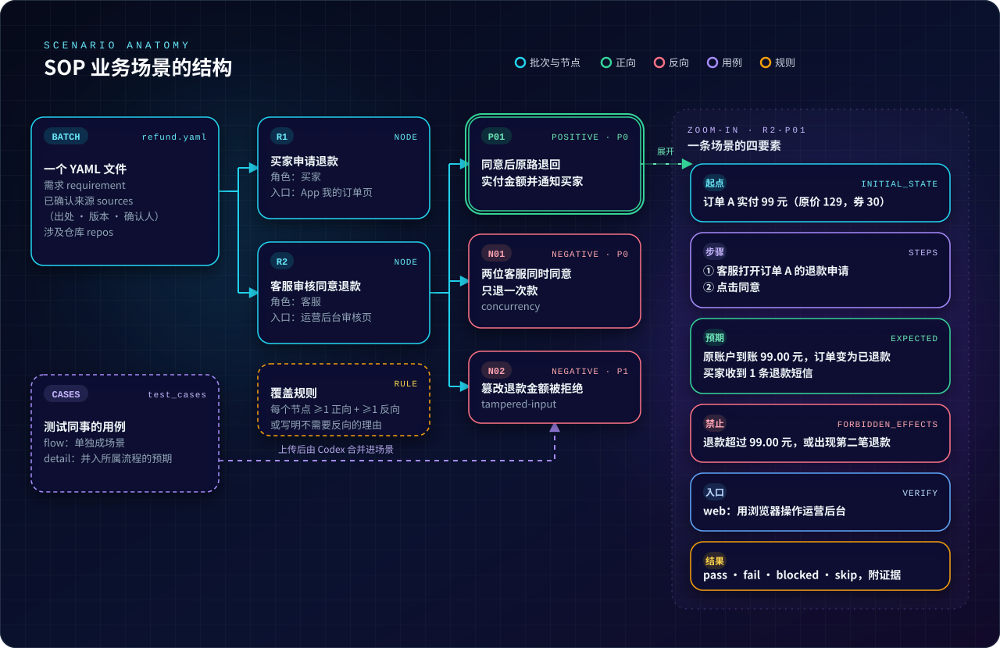

# SOP 业务场景编写指南

> **一句话：SOP 是业务方确认过的「这件事该怎么办」，SOP 业务场景是拿一个具体的例子，到真实系统上验证「它是不是真的这么办」。**

下面先用一个人人都熟悉的例子从头走一遍，再说明场景文件的结构和写法。

场景的执行、独立验收、数据核对和交付遵循[业务验收标准](standard.md)；本页集中定义场景写法、粒度与端到端范围。

## 先看一个例子：商城的「申请退款」

> 以下是为了讲解虚构的案例，不对应任何真实系统。

### ① 业务方说的规则，就是 SOP

需求评审会上，运营负责人确认了这样一段退款规则：

> 买家在 App「我的订单」页，可以对**签收 7 天内**的订单申请退款，填写原因并上传凭证。
> 客服在运营后台审核：**同意**后，系统**原路退回实付金额**，订单变为「已退款」，并给买家发一条短信；**驳回**时必须填写理由，订单恢复为「已签收」。
> **一个订单只能退一次款。**

**SOP**（Standard Operating Procedure，标准作业流程）指的就是这样一段**写下来、经业务方确认过的规则**：谁、在哪里、做什么，系统必须怎样反应。它不是测试人员自己的理解，也不是开发写完之后系统碰巧的表现。如果规则有缺口（比如「第 7 天晚上 23:59 算不算 7 天内？」），要先找业务方问清楚，再往下做。

### ② 把规则拆成业务步骤，也就是 SOP 节点

| 节点 | 谁来做 | 在哪里做 | 做什么 |
| :-: | --- | --- | --- |
| **R1** | 买家 | App「我的订单」页 | 申请退款 |
| **R2** | 客服 | 运营后台审核页 | 审核同意 |
| **R3** | 客服 | 运营后台审核页 | 审核驳回 |

### ③ 每个步骤都用具体的例子去验证，这就是场景

每条场景都要写清四件事：**从什么状态开始、做什么操作、必须看到什么、绝不能发生什么**。

| 场景 | 从什么状态开始 | 做什么操作 | 必须看到 | 绝不能发生 |
| --- | --- | --- | --- | --- |
| **R1-P01** 正向 | 订单 A 签收 3 天 | 买家申请退款，原因选「尺码不合适」，上传 1 张图 | 订单 A 变为「退款审核中」；后台待审列表出现订单 A | — |
| **R1-N01** 反向 | 订单 B 签收 8 天 | 买家打开订单 B；再直接调用退款接口 | 页面没有「申请退款」按钮；接口返回拒绝 | 生成退款单 |
| **R2-P01** 正向 | 订单 A 原价 129 元，用 30 元券后**实付 99 元**，退款审核中 | 客服点「同意」 | 买家原支付账户到账 **99.00 元**；订单变为「已退款」；买家收到 **1 条**短信 | 退款超过 99 元；出现第二笔退款 |
| **R2-N01** 反向 | 订单 A 退款审核中 | 两位客服**同时**点「同意」 | 只有一次成功，另一位看到「该退款已处理」 | 退款两次；发两条短信 |
| **R3-P01** 正向 | 订单 C 退款审核中 | 客服填写理由「凭证与商品不符」，驳回 | 订单 C 恢复「已签收」；买家看到驳回理由 | 发出退款成功短信 |
| **R3-N01** 反向 | 订单 C 退款审核中 | 客服不填理由，直接驳回 | 驳回被拒绝，提示需要填写理由 | 订单状态被改动 |

**正向场景**证明该成功的操作能成功，**反向场景**证明该拦下的操作被拦下。只测正向，就等于只测了一半的规则。

### ④ 只看「退款成功」，会漏掉什么

常见的测法是：下一单，申请退款，客服点同意，页面显示「退款成功」，判定通过。按上面的场景去验证，还能抓到这类问题：

| 可能的缺陷 | 为什么只看页面发现不了 | 哪条场景能抓到 |
| --- | --- | --- |
| 退了原价 129 元，而不是实付 99 元 | 页面照样显示「退款成功」，要查支付流水才看得出 | R2-P01 预期写死了 **99.00 元** |
| 两位客服同时点同意，退了两次款 | 一个人操作永远遇不到 | R2-N01 专门制造并发 |
| 第 8 天虽然看不到按钮，但直接调接口仍能退款 | 按钮藏起来不等于规则真的生效 | R1-N01 要求直接调用接口 |
| 驳回后买家却收到「退款成功」短信 | 后台页面一切正常，问题出在通知上 | R3-P01 把它列在「绝不能发生」里 |

这就是 SOP 业务场景的价值：**用业务方确认过的规则做标准，用具体的数字和状态做判定，把「看起来对」变成「核对过是对的」。**

## 场景文件的结构

把上面的退款例子落到文件里，就是这几层关系（图中只画了 R1、R2 两个节点）：

- **批次**：一个 YAML 文件，对应一个需求，记录规则的出处、版本和确认人。
- **SOP 节点**：规则里的一个业务步骤，写明谁来做、在哪里做。
- **场景**：对一个节点的一次具体验证，分正向和反向，并指定通过哪个**验证入口**执行（`web` 是用浏览器操作页面，`api` 是调用接口）。

<p align="center">
  
</p>

写成 YAML 就是下面这样，`R2-P01` 和 `R2-N01` 正是前面场景表格里的两行：

```yaml
metadata:
  requirement: "商城退款：签收 7 天内可申请，原路退回实付金额，每单只退一次"  # 这批场景验证的需求
  batch: "refund"                 # 批次名，与文件名一致
  version: 1
  owner: "王五"
  sources:                        # 规则的依据：出处、版本、确认人
    - ref: "docs/prd/refund.md 的 2.1–2.3 节"
      version: "v1.2（2026-10-15 评审）"
      confirmed_by: "运营负责人 李四"

sops:
  - id: R2                        # SOP 节点：一个业务步骤
    title: 客服审核同意退款
    actor: 客服                    # 谁来做
    entry: 运营后台的退款审核页      # 在哪里做
    scenarios:
      - id: R2-P01
        polarity: positive        # positive 为正向，negative 为反向
        title: 同意后原路退回实付金额，并通知买家
        actor: 客服
        priority: P0
        verify: web               # 验证入口，对应 config.yaml 的 entries
        initial_state: ["订单 A 已签收 3 天，原价 129 元，用 30 元优惠券后实付 99 元", "订单 A 处于退款审核中"]
        steps: ["客服登录运营后台，打开订单 A 的退款申请", "点击同意"]
        expected: ["买家原支付账户收到 99.00 元退款", "订单 A 状态变为已退款", "买家收到 1 条退款成功短信"]
        forbidden_effects: ["退款金额超过 99.00 元", "订单 A 出现第二笔退款流水"]
      - id: R2-N01
        polarity: negative
        negative_type: concurrency # 反向类型，见下文
        title: 两位客服同时点同意，只退一次款
        actor: 客服
        priority: P0
        verify: api
        initial_state: ["订单 A 处于退款审核中"]
        steps: ["两个客服账号同时调用同意退款接口"]
        expected: ["只有一个请求成功，另一个提示该退款已处理", "支付流水中订单 A 只有一笔 99.00 元退款"]
        forbidden_effects: ["退款两次", "买家收到两条短信"]
```

本仓库自己的真实场景文件在 [`docs/sop/`](sop)，可以对照着看。

产品仓库推荐使用 `docs/sop/<批次>.yaml`，一个批次文件保存主需求场景；分段任务引用其中的节点，如 `docs/sop/refund.yaml#R2`。采用对象、数组、文字、数字、布尔值和空值组成的 YAML 或 JSON，场景四要素为文字数组。字段要求以本仓[场景校验器](../src/sop_board/scenario_file.py)为准，入口在工作区 `config.yaml` 中绑定，见[手册与配置的分工](standard.md#手册配置与验证技能的分工)。

`metadata.sources` 保留来源原文、版本和实际确认人；推断预期先列入待回答问题，经业务确认后补入场景与确认记录。每个节点与场景使用稳定编号，保持编号在所属范围内唯一，修订时保留来源和版本关系。

## 和常见的测试用例有什么不同

| | 常见的测试用例 | SOP 业务场景 |
| --- | --- | --- |
| **预期从哪来** | 测试者对功能的理解，或者系统现在的表现 | 优先来自业务 SOP；草稿也可明确标注代码推理或批注中的业务答复，保留依据 |
| **粒度** | 单个功能点、单个按钮 | 业务链上的一个节点，把角色、入口和数据串在一起 |
| **怎么执行** | 单元测试、接口 mock、录制脚本 | 在运行中的系统上通过真实入口操作：浏览器页面或真实接口 |
| **怎么判定** | “功能正常”“页面提示成功” | 每条预期都能直接观察：页面、接口响应、库里的数据；同时核对没有发生不该发生的变化 |
| **留什么证据** | 通常只有一个结论 | 每条结果都附原始证据：截图、视频、请求与响应、数据查询结果 |

## 四要素：怎样把场景写好

| 要素 | 字段 | 写什么 | ✅ 这样写 | ❌ 不要这样写 |
| --- | --- | --- | --- | --- |
| **起点** | `initial_state` | 开始前系统和数据处于什么状态，带上具体数值 | “订单 A 实付 99 元，处于退款审核中” | “有一个订单” |
| **步骤** | `steps` | 角色在入口上的具体操作，带上实际输入值 | “客服不填理由，直接点驳回” | “测试一下驳回功能” |
| **预期** | `expected` | 能直接观察、能逐条判对错的结果，写清依据 | “原支付账户到账 99.00 元” | “退款成功”“功能正常” |
| **禁止副作用** | `forbidden_effects` | 这次操作绝对不能引起的变化 | “出现第二笔退款流水” | 不写这一项，重复退款、多发短信之类的问题就会漏检 |

> [!IMPORTANT]
> 预期优先来自已确认的 SOP，不能拿系统当前的输出当标准答案。SOP 未规定但代码有明确约束时，草稿可写入预期并标为“代码推理”；SOP 与代码冲突时以 SOP 为准，冲突列入待回答问题。两者都无法确定的内容须请业务负责人补充。

## 场景粒度

场景是唯一的验收单位。一条场景对应角色能用一句业务话描述的一件事，例如“买家申请退款后，商家在后台看到申请并能同意”。先比较完整前置状态，再判断结果：

| 用例与已有场景相比 | 写法 |
| --- | --- |
| 前置状态相同，只有取值、格式、时限或提示不同，如长度上限、空输入、时间格式、超时秒数、签名格式 | 作为细节并入该场景的 `expected`，在同一次执行中核对 |
| 前置状态相同，但要验证业务失败或拒绝的结果，如无权限、对象不存在、重复操作或依赖故障 | 写成反向场景，明确拒绝结果与禁止副作用 |
| 前置状态不同，如多角色同时在线、已有数据或状态、重复或并发操作、已过一段时间 | 写成新场景；后续分段加深的内容放在该段新增节点中 |

一条细节只归属一个场景；新场景仍按其业务结果标正向或反向。主需求控制在十几条，主流程每个业务节点一条正向，加业务反向。超过 20 条先拆小需求；确需保留时在方案验收节说明理由并交评审确认。记录总场景数与各节点条数，子任务沿用主需求文件，只增加本段接通的节点。

复杂需求的用例集覆盖主流程，由测试同事提供；没有测试同事时由未参与实现的验收者编写并确认，规模与场景相当，子任务共用。细节用例按[用例合并](#测试同事的用例怎样变成场景)归入流程，保留来源编号和每条原预期。

## 端到端场景的边界

端到端（E2E）指从实际使用入口经过声明范围内的真实关键环节，核对最终可观察结果。执行前在场景或其引用的项目手册中填写以下范围记录，结果和交付记录引用它：

| 范围项 | 写清什么 |
| --- | --- |
| 起点 | 操作角色、前置状态、实际入口与触发动作 |
| 终点 | 谁能在什么位置观察到什么结果，包括数据变化与禁止副作用 |
| 真实关键环节 | 经过的服务、存储、队列、网关、连接及实际运行的依赖 |
| 替代依赖 | 哪些环节被替代，以及为什么 |
| 未覆盖范围 | 替代依赖截断的部分、尚未到达的终点和仍需人工执行的范围 |

例如要求“成员收到提醒”，须从实际触发入口经过提醒生成、转发和订阅链路，到实际成员连接捕获消息，核对身份、内容、次数和不应接收的对象；次数与时限来自已确认业务要求。只记录实际走过的链路，未到达的环节留在未覆盖范围。业务、路由、认证、连接或依赖变化后重新核对这份记录。

## 业务 SOP 怎样写

本节是人工阅读的正文。下面的编写规则同步维护在随包资源 [author-sop-guide.md](../src/sop_board/prompts/author-sop-guide.md)，`sop prepare` 将其复制到任务目录的 sop-guide.md，并在提示词中给出实际路径；安装 wheel 后也能直接读取，不依赖源码检出。修改规则时同步两处，交付前核对内容一致。

<!-- author-sop-rules:start -->

先收集使用者指定的 PRD、需求描述、业务评审结论与技术方案，注明文件名和版本。业务 SOP 的结果只来自业务资料及针对当前问题的真人答复；技术方案和代码只帮助确定角色、入口、字段与状态名。技术实现细节不转成业务要求。资料之间或资料与代码矛盾时，保留双方原文并提问；资料未写明的结果同样列为待确认，不能按当前实现补答案。这是编写业务 SOP 阶段的规则；后续从 SOP 生成场景草稿时的代码推理仍须单独标注。

人工编写与会话提示词共用以下结构：

| 部分 | 写清什么 |
| --- | --- |
| 业务目标与范围 | 要完成的业务结果、开始与结束边界、包含与不包含的事项 |
| 角色 | 谁提出、谁处理、谁确认，分别从哪个入口参与 |
| 按节点编号的业务规则 | R1、R2…逐条写条件、操作、结果，附来源文件与原文摘录；未知内容标问题编号 |
| 流程图 | 用 mermaid 表达主流程与条件分支，未知分支明确待确认 |
| 禁止的副作用 | 资料明确禁止发生的业务结果；没有依据时先提问，不自创限制 |
| 未覆盖范围 | 不属于本次需求、缺资料或尚需人工确认的业务范围及原因；是否生成验收场景、是否登记等过程说明另在会话中报告 |
| 问题与业务答复 | 每个问题依次写标题、具体场景、目前的写法、缺什么、单个请确认的问题、涉及内容，附相关原文；记录实际答复人与原话 |

例如 PRD 写“退款 7 天内可申请”，技术方案写“退款 15 天内可申请”：规则先写“申请期限待确认 Q1”，问题引用两处原文并直接问“签收后多长时间内可以申请退款？”，不能自行挑 7 天或 15 天。每个问题只问一个所需的业务决定，不预设答案，也不暗示继续待定或排除范围。技术方案中的“退款单号用雪花算法生成”不成为业务预期。得到业务答复后将确定的口径写回规则和流程图，明确暂不纳入的业务写入未覆盖范围并保留原因；保留问题、来源与答复人，答复不足时追加具体问题。

登记前的最终 SOP 标题与正文使用确定的业务表述，去掉“待业务确认”“确认稿”等过程状态措辞及已解决的待确认占位；答复仍不足则继续提问，不提交。确认人与确认状态由登记命令附加，正文不自行填写。问题与业务答复作为历史原文保留，不为清理正文而改写它们。请使用者在本次请求中指定确认人，缺姓名时直接询问，不提供示例姓名，也不借用此前的自我介绍、上传人或答复人。

<!-- author-sop-rules:end -->

会话编写使用 `sop prepare --source … --session …` 固定资料，先呈报，再由 `sop answer --question … --text … --author …` 记录本问题的原话。更新正文、处理全部问题后，使用者在本次请求中指定确认人，才能 `sop submit --task … --confirmed-by …`。不得从自我介绍、其他角色或旧问题借用姓名及答复。登记时确认人同时作为原文登记人；已有文件另有上传人时用 `sop upload` 分别指定。

来源资料复制到本机任务目录，原路径与副本仅本机可见；登记后的 SOP 页只读展示文件名、内容摘要、业务答复与确认人。原文中的答复时间与页面共用看板显示时区，数据库及 answers.json 保留原始时间。登记后报告版本和 CLI 返回的位置；看板未运行时照实说明，不为找链接额外运行命令。命令格式、输出与重复登记规则见[参考手册](reference.md#编写业务-sop)。

## 从业务 SOP 到可确认的草稿

首页或批次概览可上传 Markdown / 纯文本 SOP，填写业务确认人；提交人取身份栏的标记人。生成后打开“草稿”，核对每条规则的正向、负向覆盖或负向豁免理由，再逐条查看用例的预期。

- **SOP 依据**：预期来自 SOP 原文。
- **代码推理**：SOP 未写明的预期由代码约束推导，旁边显示仓库别名、文件和行号。同一用例混有 SOP 与代码来源时也标为代码推理，说明中区分哪些预期来自代码。
- **批注确认**：预期来自批注中的业务答复，旁边显示批注编号（如 `#7`），可以在批注列表核对作者和原文。

例如，代码限制退款理由不超过 200 字，但业务答复为 100 字：先在身份栏填写标记人，在对应的代码推理用例旁添加“修改意见”，写明“业务确认上限为 100 字”。若草稿已将这点列成问题，也可在问题旁选择“回答问题”。点“按反馈修订”后，核对新版预期变成 100 字、标记变成“批注确认”并引用该批注；版本差异和处理说明保留修改依据。未采纳的意见也必须有理由，可在批注旁手动标为未采纳并留下记录。

确认前会提示待处理批注、待回答问题与代码推理用例数。点“仍然确认”后，未处理项留在草稿的确认记录中，分别标为“确认时未处理”和“确认时未回答”，不会混进用例 YAML。确认后的草稿不能再批注或修订；后续可上传 SOP 新版本。确认会登记为一次用例上传，与直接上传用例共用合并和执行流程。

## 正向与反向

每个 SOP 节点至少要有**一条正向场景和一条反向场景**。如果某个节点确实没有反向情况，要在 `negative_exempt` 里写明理由。反向场景用 `negative_type` 标明属于哪一类：

| 类别 | 反向类型 | 退款案例里的例子 |
| --- | --- | --- |
| 输入有问题 | `empty-input` `over-length` `invalid-input` `incomplete-input` `tampered-input` | 驳回不填理由；通过接口把退款金额改成 129 元 |
| 资源状态 | `not-found` `archived` `duplicate` `stale-input` | 已经退过款的订单再次申请；页面停留太久，提交时订单已被他人处理 |
| 权限边界 | `permission` `cross-tenant` | 买家账号调用客服的审核接口；A 店铺的客服审核 B 店铺的订单 |
| 运行异常 | `concurrency` `disconnect` `timeout` `interrupted` | 两位客服同时同意；支付渠道退款回调超时 |
| 其他 | `other` | 以上都不合适时使用，写清楚原因 |

项目还应按业务风险覆盖顺序变化、依赖服务故障，以及已归档或停用资源上的操作；在项目手册列出本项目最重要的反向场景。

## 测试同事的用例怎样变成场景

测试同事用熟悉的格式写用例，不需要先学场景的写法：

```yaml
metadata: {module: 售后, feature: 退款审核, owner: 张三, last_reviewed: "2026-10-21"}
test_cases:
  - id: TC_REFUND_REJECT_001
    title: 驳回退款时必须填写理由
    priority: P1                  # P0 / P1 / P2
    type: functional              # functional / ui / security / performance / accessibility
    preconditions: ["订单 C 处于退款审核中"]
    steps: ["客服打开订单 C 的退款申请", "理由留空，点击驳回"]
    expected_results: ["驳回被拒绝，提示需要填写理由", "订单 C 仍为退款审核中"]
    tags: ["negative"]
```

把用例上传到批次后，Codex 会逐条判断：

- **flow**：这条用例本身是一条完整的业务流程，就生成一条同编号的场景；
- **detail**：这条用例只是某个流程里的一项细节检查，它的预期会标上 `[用例 编号]`，并入所属流程场景的 `expected`。

合并页会列出每条用例归到了哪个场景，以及这样归类的理由。开发者可以把某条细节用例改为单独成场景。执行时，Agent 既核对场景的预期，也核对来源用例的前置条件、步骤和预期。

### 合并提示待补充时

合并页和用例页用问题单展示待补充内容：标题、具体场景、用例目前的写法或现状、缺什么、已知口径、请确认、涉及用例（编号和标题）。会话逐项使用入口技能的六段呈报模板，不汇成表格或一行摘要；编写 SOP 尚无用例时列明相关规则或资料章节，不编造用例编号。每个问题只问一件事，场景沿用用例中的数值与对象；可选回答仅帮助表达，选项本身不代表已确认规则。

**业务规则缺口**表示依据不足，例如积分周期的长度或切换时区尚未确定，需要分别确认。**入口缺口**标为“由开发者处理”，表示看板尚不能完成所需操作，例如用例要求读取邀请邮件，但看板目前只能操作网页和接口。

在合并页填写身份栏的标记人，在问题下回复，或用通用说明补充与多条用例相关的口径。回复即回复人确认的业务依据；请先取得业务确认再提交。采纳后看板直接更新用例，并记录回复人、日期及对应回复编号；用例页可查看与上一版的对比，下载的用例并集也是更新后的版本。答复不足时保留缺口并追问，运行中提交的补充留到下一轮。后来上传旧文件时，已采纳的澄清仍保留在历史中，合并会再次按澄清更新，或对新的含义追问。

入口缺口标为“由开发者处理”：开发者补齐 `config.yaml` 中真实可用的入口并重新自检后重新合并；仅凭文字回复不能消除。也可以在卡片上选择“本批不纳入”，填写理由，例如“本批由人工完成”。相关用例仍可下载，但不生成场景、不计入缺口和暂缓数量；用例页可逐条“重新纳入”。不能用产品当前输出替代确认依据。

有缺口时，可确定的流程仍会落地。暂缓细节此前没有并入某流程的，该流程不加入它的预期；此前已并入的，流程可以更新，但保留上一版中该细节的带编号预期、来源引用与配对。暂缓的整条流程已有场景时，沿用整条旧场景及历史。两种沿用都标“用例已更新，新内容待补充”。待补充的新内容单独计数，不算作已验证；保留旧细节的更新流程仍照常执行，整条暂缓的场景排除在当前进度与通过率之外。补齐后重新合并，内容变化的场景恢复待执行。

## 记住三句话

1. **SOP 是业务方确认过的规则**，不是测试人员的理解，也不是系统现在的表现。
2. **场景是对规则的一次具体验证**：从什么状态开始、做什么、必须看到什么、绝不能发生什么，四件事缺一不可。
3. **正反都要测，结果要有证据**：该成功的成功，该拦下的拦下，每条结论都附截图、接口响应或数据查询结果。
