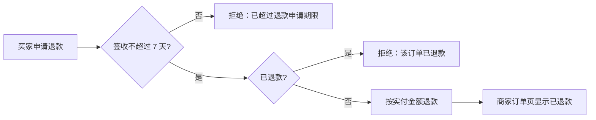

# 演示商城退款业务 SOP

## 业务目标与范围

买家在签收后的期限内申请退款，商家在订单页看到退款状态。
范围：签收 7 天内（含第 7 天）的已签收订单；不含部分退款。

## 角色

- 买家：通过退款接口申请退款
- 商家：在订单页查看退款状态

## 业务规则

### R1 申请期限

签收第 1～7 天可以申请；第 8 天起拒绝，提示已超过退款申请期限。
期限按签收日计算，与下单日无关。

### R2 退款金额与次数

退款金额等于实付金额（TC_REFUND_AMOUNT_001）；每单只退一次，重复申请返回“该订单已退款”。

## 流程图

## 禁止的副作用

- 同一订单出现第二笔成功退款
- 退款金额超过实付金额

## 未覆盖范围

- 部分退款

## 确认记录

- 演示负责人确认（演示 v1）
