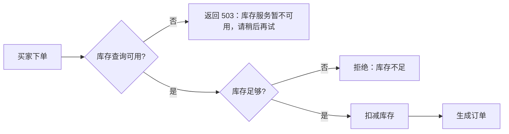

# 演示商城下单与库存业务 SOP

## 业务目标与范围

买家下单时按购买数量扣减库存；库存查询不可用时，下单明确告知买家稍后再试，不留下半截订单。
范围：单件商品的下单；不含退款回补库存、预占库存与超时取消。

## 角色

- 买家：通过下单接口下单
- 库存查询与扣减：商城下单时依赖的库存能力

## 业务规则

### R1 下单扣减库存

下单先扣减对应商品的库存，扣减成功后才生成订单；库存不足时拒绝下单，提示“库存不足”，不生成订单。

### R2 库存查询不可用时的降级

库存查询或扣减得不到应答时，下单接口返回 503，提示“库存服务暂不可用，请稍后再试”，不生成订单，也不扣减库存。
库存恢复后，买家重新下单按 R1 处理。

## 流程图

## 禁止的副作用

- 库存查询不可用时生成订单
- 一次下单扣减的库存多于购买数量

## 未覆盖范围

- 退款后回补库存
- 预占库存与超时取消

## 确认记录

- 演示负责人确认（演示 v1）
